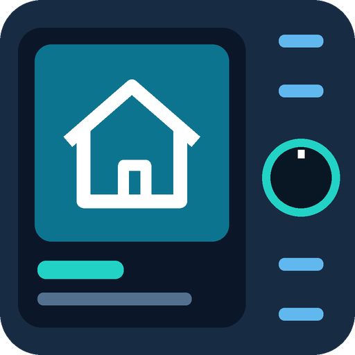

<p align="center"></p>

# Tuya HA Wall Panel

A modular Android wall-panel app and a local Home Assistant integration for
dashboard, knob, buttons, relays, display, audio and SIP video intercom control.

[ARM32/ARM64 build and hardware status](unified-app/MULTI_ABI.md).

**Release v1.18.0:** HA integration **1.18.0**, unified Android app **0.23.0**,
and standalone Audio Receiver **1.2.0**. Both APKs include ARM32 and ARM64.

**[Download APKs and installation files](https://github.com/Hollako/tuya-ha-wall-panel/releases/tag/v1.18.0)**
— open **Assets** below the release notes:

- `tuya-wall-panel-0.23.0.apk`: unified dashboard, hardware, SIP and optional AirPlay.
- `audio-receiver-1.2.0.apk`: standalone AirPlay receiver, without the unified UI.
- `tuya-wall-panel-0.23.0-setup.zip`: unified APK and one-time setup/migration tools.
- `tuya-wall-panel.zip`: HA integration for manual installation; HACS installs it separately.
- `receiver-native-source-and-relink-1.2.0.tar.gz`: matching native sources, notices,
  configuration, objects and libraries. `SHA256SUMS.txt` covers all downloads.

Install one receiver product on a panel. The unified app already includes AirPlay;
do not also run the standalone receiver there. APK installation preserves settings
when its package and signing identity match. Initial privileged preparation is
still required on supported firmware; the APK cannot grant itself root.
Tested hardware: **Sznaner G10 Music Host / Rockchip PX30, Android 8, 2 GB RAM**.
Other Tuya models require hardware discovery and a matching adapter; installing
the app alone does not make an untested model compatible with the G10 wiring.

## Install the HA integration with HACS

[](https://my.home-assistant.io/redirect/hacs_repository/?owner=Hollako&repository=tuya-ha-wall-panel&category=integration)

1. Open **HACS → ⋮ → Custom repositories**.
2. Add `https://github.com/Hollako/tuya-ha-wall-panel` as **Integration**.
3. Download **Tuya HA Wall Panel**, then restart Home Assistant.
4. Open **Settings → Devices & services → Add integration → Tuya Wall Panel**.
5. Enter the panel's MQTT base topic and choose its knob pages and button actions.

For an existing `tuya_wall_panel` setup, install over the same integration and
restart HA. Keep the existing entry and MQTT topic; do not delete and re-add it.
This is a HACS **custom repository**, not a claim of inclusion in HACS's default
catalog. HACS installs the HA integration; the Android APK is installed separately.

Requires the HA MQTT integration and an MQTT broker. Local integration brand icons
require Home Assistant 2026.3 or newer. No cloud service is required by this project.

## Features

- Knob pages for lights, climate, covers and media players; weather/date/time screensaver.
- Four independent button event streams and configurable single/double actions.
- Two relays, with optional local button assignments that work offline.
- Main display brightness, dim/off timers, instant wake and knob display controls.
- Local knob-only activity wake/white LED, returning to red LED and the configured idle screensaver after 15 seconds.
- Audio media player, volume/mute, source selection and amplifier routing.
- Shared AirPlay receiver engine, local media/knob feedback, live HA timing/trim controls and local SIP call interruption.
- Dashboard URL, Open setup, Reload dashboard, Restart app, reboot and screenshots.
- Optional SIP intercom with two-way audio, ringtone and an uncropped RTSP preview.
- Hikvision door-unlock adapter; a second door can be enabled in settings.
- Independent network selection for HA/dashboard/MQTT and SIP/RTSP.
- Root-backed kiosk restrictions and administrator access on supported panels.

Modules can be enabled independently to match the panel's hardware. Some LED
controls remain limited by the MCU firmware. The three manual knob text entities
are retired; the controller continues sending complete display frames internally.

## Android app

Download the APK from [Releases](https://github.com/Hollako/tuya-ha-wall-panel/releases).
Configure the HA/dashboard address, MQTT connection, hardware profile and optional
Intercom settings in the app. Back up a panel before hardware preparation. Direct
hardware and kiosk functions require root and the matching privileged support;
generic SIP does not require taking ownership of unsupported Tuya hardware.

See [app architecture](unified-app/ARCHITECTURE.md),
[panel provisioning](unified-app/PROVISIONING_PLAN.md),
[network routing](unified-app/NETWORK_ROUTING.md),
[dashboard compatibility](unified-app/DASHBOARD_RENDERING.md) and
[recovery controls](unified-app/APP_RECOVERY.md).
Older migration notes describe development history, not the current installation.

## Source layout

| Directory | Purpose |
| --- | --- |
| `custom_components/tuya_wall_panel` | Canonical HACS integration source and local brand assets |
| `unified-app/src` | Android app, SIP, WebView and MQTT runtime |
| `shared/audio-receiver` | Single receiver engine consumed by unified and standalone APKs |
| `shared/sip` | Single SIP protocol/codec core |
| `airplay-app` | Dedicated receiver launcher, native backend and build recipes |
| `unified-app/native` | Privileged hardware worker, display/audio and management |
| `unified-app/assets/provision` | Supported-panel preparation and restore scripts |
| `wallpanel-hardware` | MCU protocol headers required by the native build |
| `panel-172.16.1.26` | Shared hardware source headers; directory name is historical |
| `ha-knob` | HA isolated tests, packaging and migration documentation |
| `audio/fetch_build_tools.py` | Fetches the legacy Java/Android compilation tools |

Private settings, signing keys, device dumps, vendor firmware, deployment reports
and historical APKs are excluded. Source publication does not expose the installed
panel's MQTT, SIP, camera or HA credentials.

## Development

Current development builds: unified app **0.29.1**, dedicated audio receiver
**1.7.1**, and HA integration **1.22.0**. New features include panel discovery,
saved audio groups, independent room volume/mute/timing, local music browsing
through the web UI and HA, AirPlay transport/artwork improvements, and settings
navigation improvements. See [group documentation](shared/multiroom/GROUPS.md).

**Bluetooth grouping is experimental.** The tested A133 firmware can invalidate
its Bluetooth audio stream when the group capture route changes. Prepare the
Bluetooth group before reconnecting the phone; reapplying the same Bluetooth
input now preserves the capture route. Audio was heard on the test panels, but
the initial disconnect and remaining stability issues are unresolved. See
[Bluetooth notes](shared/multiroom/BLUETOOTH.md).

See [BUILDING.md](BUILDING.md) for the existing Windows/WSL toolchain. The Android
build is currently developer-oriented and needs local tool paths. A developer
build signed with a different key cannot update an existing signed installation.
Keep the original private signing identity outside Git.

```sh
python scripts/validate_repository.py
python -m unittest discover -s ha-knob -p 'test_*.py'
python ha-knob/build_package.py
```

The isolated tests use fake HA/MQTT and fake Android services. Hardware, call,
audio, relay and reboot tests belong on a suitable test panel under user control.

Third-party dependencies retain their own licenses; see
[THIRD_PARTY.md](THIRD_PARTY.md). This is an independent project, unaffiliated
with Tuya, Home Assistant or the panel manufacturer.
